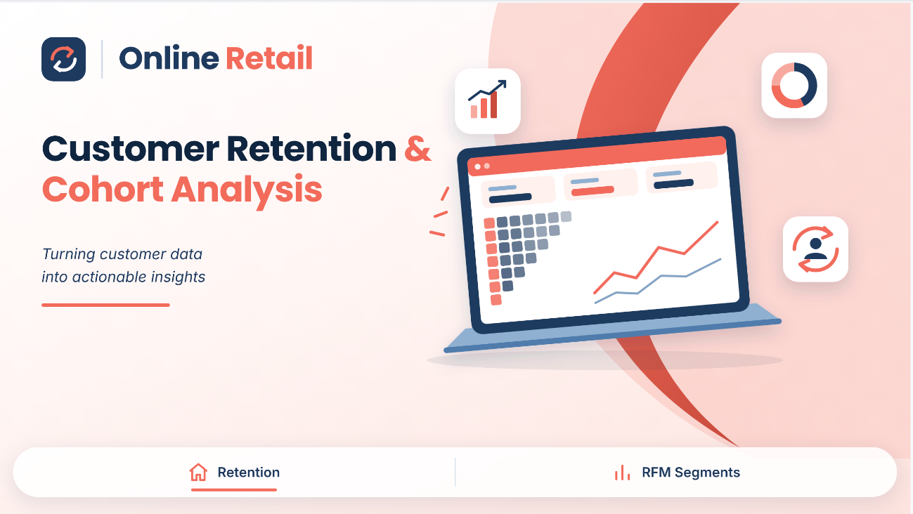
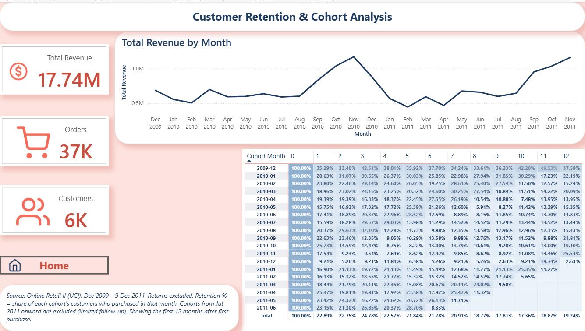
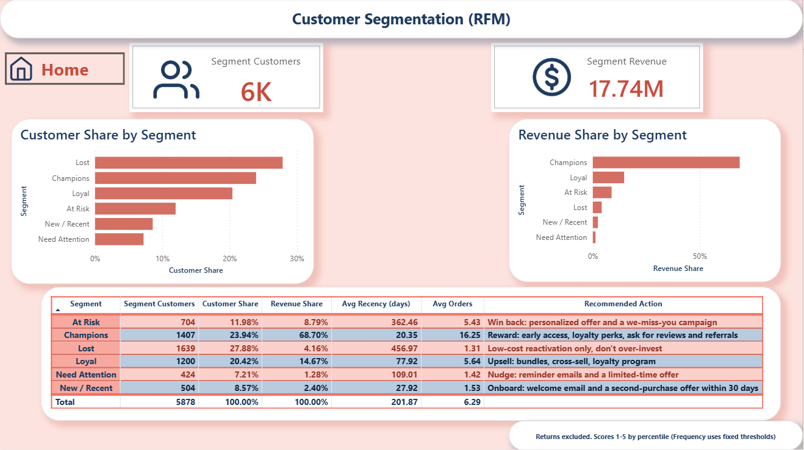

# Customer Retention & RFM Segmentation — Power BI

Cohort retention analysis and RFM customer segmentation on a real UK online-retail dataset,
built as a 3-page Power BI report with a recommended action for every customer segment.

🇪🇬 النسخة العربية: [README_AR.md](README_AR.md)



## Business question

Which customers come back, which ones are drifting away, and what should the business do about each group?

## Dashboard

| Page | What it shows |
|---|---|
| **Cover** | Navigation to the two analysis pages |
| **Retention** | Revenue, orders, customers, monthly revenue trend, and a cohort retention matrix (first 12 months) |
| **RFM** | Six customer segments, each one's share of customers and revenue, and a recommended action |




## Key findings

All figures are read from the dashboard. Explanations marked *hypothesis* were not tested against the data.

1. **Repeat buying is a steady core, not a quickly fading tail.** Across the Dec 2009 – Jun 2011 cohorts, the matrix's Total row shows about 23% of a cohort buying again in month 1 (22.89%) and 19.24% still buying in month 12.
2. **Revenue is concentrated.** Champions are 23.9% of customers but 68.7% of revenue. Champions + Loyal are 44.4% of customers and 83.4% of revenue. The Lost segment is 27.9% of customers but only 4.2% of revenue.
3. **Cohort quality varies a lot.** The Dec 2009 cohort retains best (35.29% in month 1, 42.51% in month 3); the Dec 2010 cohort is weakest (9.21% in month 1, 5.26% in month 2). *Hypothesis:* the Dec 2009 cohort includes customers who already existed before the data starts, and the Dec 2010 cohort may be mostly seasonal gift buyers.
4. **A win-back audience exists.** The At Risk segment has 704 customers (12.0%) who used to buy often (5.4 orders on average) but have not bought for about 362 days on average. They account for 8.8% of historical revenue (about £1.6M). *Hypothesis:* some of them are seasonal buyers rather than truly churned.

## Recommended actions by segment

| Segment | Customers | Customer share | Revenue share | Action |
|---|---:|---:|---:|---|
| Champions | 1,407 | 23.94% | 68.70% | Reward: early access, loyalty perks, ask for reviews and referrals |
| Loyal | 1,200 | 20.42% | 14.67% | Upsell: bundles, cross-sell, loyalty program |
| New / Recent | 504 | 8.57% | 2.40% | Onboard: welcome email and a second-purchase offer within 30 days |
| Need Attention | 424 | 7.21% | 1.28% | Nudge: reminder emails and a limited-time offer |
| At Risk | 704 | 11.98% | 8.79% | Win back: personalized offer and a we-miss-you campaign |
| Lost | 1,639 | 27.88% | 4.16% | Low-cost reactivation only, don't over-invest |

## Definitions

**Cohort** — the calendar month of a customer's first purchase (returns excluded).
**Retention %** — share of a cohort's customers who purchased in month N after the cohort month. It is *not cumulative*: a customer can be active in month 1, absent in month 2 and active again in month 3.

**RFM** — computed per customer as of **10 Dec 2011** (the day after the last transaction):
- **Recency**: days since the last purchase. **Frequency**: number of distinct invoices. **Monetary**: total spend.
- Scores from 1 to 5. Recency and Monetary use quintiles (percentiles). Frequency uses fixed thresholds: 1 → 1, 2 → 2, 3–4 → 3, 5–8 → 4, 9+ → 5.
- Segment rules (evaluated in this order):

| Segment | Rule |
|---|---|
| Champions | R ≥ 4 and F ≥ 4 |
| Loyal | R ≥ 3 and F ≥ 3 |
| New / Recent | R ≥ 4 and F ≤ 2 |
| At Risk | R ≤ 2 and F ≥ 3 |
| Lost | R ≤ 2 and F ≤ 2 |
| Need Attention | everything else |

These rules are my own heuristics, not an industry standard. Different thresholds would move customers between segments.

## Data

**Online Retail II**, UCI Machine Learning Repository — transactions of a UK-based online gift-ware retailer, 1 Dec 2009 to 9 Dec 2011. Many of its customers are wholesalers. Unit prices are in GBP.

Chen, D. (2012). *Online Retail II* [Dataset]. UCI Machine Learning Repository. https://doi.org/10.24432/C5CG6D — licensed under CC BY 4.0.

See [data/README.md](data/README.md) for details.

## Data preparation (Power Query)

- Invoice kept as text, because cancellations start with the letter "C".
- Rows without a Customer ID removed (they cannot be tracked per customer): 1,067,371 rows in the UCI dataset → 824,364 rows used.
- Added `Revenue` (Quantity × Price), `IsReturn` (invoice starts with "C") and `InvoiceDay` (date without time).
- Returns and rows with zero or negative quantity/price are excluded from revenue, orders and customer counts.

## Data model

`Sales` (fact table) → `Calendar` (date table, relationship `Sales[InvoiceDay]` → `Calendar[Date]`).
`RFM Customers` is a calculated table with one row per customer and is deliberately not related to `Calendar`, so date filters do not change the segments.

## Repository structure

```
README.md / README_AR.md      Overview (English / Arabic)
report/                       Full written report (Report_EN.md, Report_AR.md)
dax/                          DAX measures and Power Query (M) code
dashboard/                    PBIX file, PDF export, screenshots
data/                         Summary tables (CSV) and data source notes
assets/                       Power BI theme and icons
```

## How to open

1. Open `dashboard/online_retail_retention.pbix` in **Power BI Desktop** (Windows).
2. The file contains an imported copy of the dataset, so it opens without the original CSV.
3. To refresh from your own copy of the CSV: **Home → Transform data → Source** and update the file path.
4. Optional: **View → Themes → Browse for themes** and load `assets/navy_coral_theme.json`.

## Limitations

- Customers without a Customer ID are excluded, so the results describe identified customers only.
- The data starts in Dec 2009, so the Dec 2009 "first purchase" is not necessarily a customer's real first purchase. That cohort is likely overstated.
- Many customers are wholesalers, so the patterns may not transfer to a typical consumer store.
- Cohorts from Jul 2011 onward are not shown (too little follow-up), and only the first 12 months are displayed.
- The dashboard shows what happened, not why. Explanations here are hypotheses.
- Revenue excludes returns, so it is gross of returns.

## Previous project

This project is a step after my earlier dashboard, [Olist E-Commerce Analytics Dashboard](https://github.com/mohamedlamiaa291-bit/olist-ecommerce-powerbi-dashboard), which focused on reporting revenue, orders, categories and delivery. Here the focus moves to a business question (which customers come back, and what to do about each group), using cohort retention and RFM segmentation.

## Author

**Lamiaa Mohamed** — Data Analyst (Power BI, Power Query, DAX)
LinkedIn: [https://www.linkedin.com/in/lamiaa-mohamed-422770438/](https://www.linkedin.com/in/lamiaa-mohamed-422770438/) · GitHub: [https://github.com/mohamedlamiaa291-bit](https://github.com/mohamedlamiaa291-bit) · Kaggle: [https://www.kaggle.com/lamiaamohamed2026](https://www.kaggle.com/lamiaamohamed2026)
