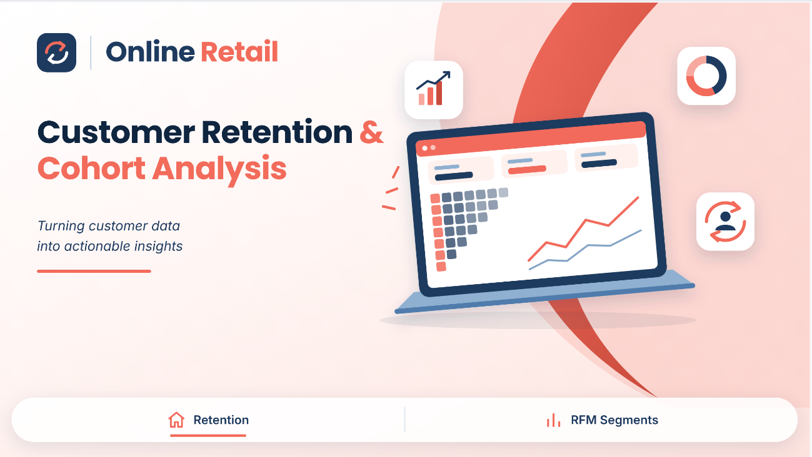
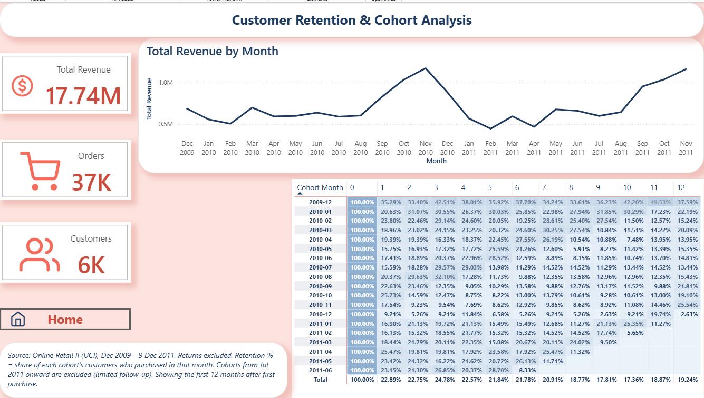
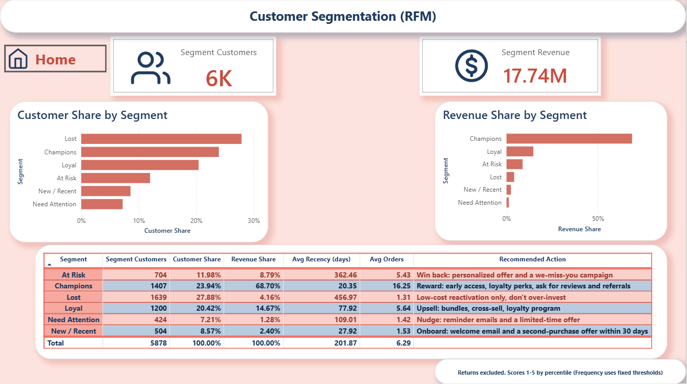

# تحليل الاحتفاظ بالعملاء وتقسيمهم (RFM) — Power BI

تحليل Cohort Retention وتقسيم العملاء بطريقة RFM على بيانات حقيقية لمتجر إلكتروني بريطاني،
في تقرير Power BI من 3 صفحات، مع إجراء مقترح لكل شريحة عملاء.

🇬🇧 English version: [README.md](README.md)



## سؤال العمل

مين العملاء اللي بيرجعوا يشتروا، ومين بيبعد، وإيه اللي يتعمل مع كل مجموعة؟

## لوحة التقرير

| الصفحة | ما تعرضه |
|---|---|
| **Cover** | الغلاف وأزرار التنقل |
| **Retention** | الإيراد وعدد الطلبات والعملاء، واتجاه الإيراد الشهري، ومصفوفة الاحتفاظ (أول 12 شهر) |
| **RFM** | ست شرائح عملاء، ونسبة كل شريحة من العملاء والإيراد، والإجراء المقترح |




## أهم النتائج

كل الأرقام مقروءة من اللوحة. التفسيرات المكتوبة كـ *فرضية* لم تُختبر على البيانات.

1. **الشراء المتكرر قاعدة ثابتة وليس ذيلًا يتلاشى بسرعة.** في مجموعات ديسمبر 2009 حتى يونيو 2011، صف الإجمالي في المصفوفة يوضح أن حوالي 23% من المجموعة يشتري مرة أخرى في الشهر الأول (22.89%)، ولا يزال 19.24% يشتري في الشهر 12.
2. **الإيراد مركّز في شريحة صغيرة.** شريحة Champions تمثل 23.9% من العملاء و68.7% من الإيراد. Champions مع Loyal يمثلان 44.4% من العملاء و83.4% من الإيراد. أما شريحة Lost فهي 27.9% من العملاء وتجلب 4.2% فقط من الإيراد.
3. **جودة المجموعات تختلف كثيرًا.** مجموعة ديسمبر 2009 هي الأفضل في الاحتفاظ (35.29% في الشهر الأول و42.51% في الشهر الثالث)، ومجموعة ديسمبر 2010 هي الأضعف (9.21% في الشهر الأول و5.26% في الشهر الثاني). *فرضية:* مجموعة ديسمبر 2009 تضم عملاء كانوا موجودين قبل بداية البيانات، ومجموعة ديسمبر 2010 ربما معظمها مشترو هدايا موسميون.
4. **يوجد جمهور لحملات الاسترجاع.** شريحة At Risk فيها 704 عملاء (12.0%) كانوا يشترون كثيرًا (متوسط 5.4 طلب) لكن لم يشتروا منذ حوالي 362 يومًا في المتوسط. يمثلون 8.8% من الإيراد التاريخي (حوالي 1.6 مليون جنيه إسترليني). *فرضية:* بعضهم مشترون موسميون وليسوا بالضرورة عملاء ضاعوا.

## الإجراء المقترح لكل شريحة

| الشريحة | العملاء | نسبة العملاء | نسبة الإيراد | الإجراء |
|---|---:|---:|---:|---|
| Champions | 1,407 | 23.94% | 68.70% | مكافأتهم: وصول مبكر، مزايا ولاء، طلب تقييمات وترشيحات |
| Loyal | 1,200 | 20.42% | 14.67% | بيع إضافي: باقات وبيع متقاطع وبرنامج ولاء |
| New / Recent | 504 | 8.57% | 2.40% | ترحيب وعرض لشراء ثانٍ خلال 30 يومًا |
| Need Attention | 424 | 7.21% | 1.28% | تذكير وعرض محدود المدة |
| At Risk | 704 | 11.98% | 8.79% | استرجاع: عرض مخصص وحملة "افتقدناك" |
| Lost | 1,639 | 27.88% | 4.16% | إعادة تنشيط منخفضة التكلفة فقط، بدون استثمار كبير |

## التعريفات

**المجموعة (Cohort):** شهر أول عملية شراء للعميل (بدون المرتجعات).
**Retention %:** نسبة عملاء المجموعة الذين اشتروا في الشهر N بعد شهر البداية. هي **ليست تراكمية**: العميل ممكن يشتري في الشهر 1، ويغيب في الشهر 2، ويرجع في الشهر 3.

**RFM:** تُحسب لكل عميل حتى تاريخ **10 ديسمبر 2011** (اليوم التالي لآخر معاملة):
- **Recency:** عدد الأيام منذ آخر شراء. **Frequency:** عدد الفواتير المختلفة. **Monetary:** إجمالي الإنفاق.
- الدرجات من 1 إلى 5. Recency وMonetary بالشرائح المئوية (Quintiles). Frequency بحدود ثابتة: 1 ← 1، و2 ← 2، و3–4 ← 3، و5–8 ← 4، و9 فأكثر ← 5.
- قواعد الشرائح (بهذا الترتيب):

| الشريحة | القاعدة |
|---|---|
| Champions | R ≥ 4 و F ≥ 4 |
| Loyal | R ≥ 3 و F ≥ 3 |
| New / Recent | R ≥ 4 و F ≤ 2 |
| At Risk | R ≤ 2 و F ≥ 3 |
| Lost | R ≤ 2 و F ≤ 2 |
| Need Attention | أي حالة أخرى |

هذه القواعد اجتهاد مني وليست معيارًا صناعيًا. تغيير الحدود سينقل عملاء بين الشرائح.

## البيانات

**Online Retail II** من مستودع UCI للتعلم الآلي: معاملات متجر إلكتروني بريطاني لبيع الهدايا، من 1 ديسمبر 2009 إلى 9 ديسمبر 2011. كثير من عملائه تجار جملة. الأسعار بالجنيه الإسترليني.

Chen, D. (2012). *Online Retail II* [Dataset]. UCI Machine Learning Repository. https://doi.org/10.24432/C5CG6D — بترخيص CC BY 4.0.

التفاصيل في [data/README.md](data/README.md).

## تجهيز البيانات (Power Query)

- عمود Invoice بنوع نص، لأن فواتير الإلغاء تبدأ بحرف "C".
- حذف الصفوف التي بلا Customer ID لأنه لا يمكن تتبعها لكل عميل: من 1,067,371 صفًا في بيانات UCI إلى 824,364 صفًا مستخدمًا.
- إضافة `Revenue` (الكمية × السعر) و`IsReturn` (الفاتورة تبدأ بـ C) و`InvoiceDay` (التاريخ بدون وقت).
- المرتجعات والصفوف ذات الكمية أو السعر صفر أو سالب مستبعدة من الإيراد والطلبات وعدد العملاء.

## نموذج البيانات

جدول `Sales` (الحقائق) مرتبط بجدول `Calendar` (التواريخ) عبر `Sales[InvoiceDay]` ← `Calendar[Date]`.
جدول `RFM Customers` جدول محسوب بصف لكل عميل، وهو غير مرتبط بـ `Calendar` عمدًا، حتى لا تغيّر فلاتر التاريخ الشرائح.

## هيكل المشروع

```
README.md / README_AR.md      نظرة عامة (إنجليزي / عربي)
report/                       التقرير الكامل (Report_EN.md, Report_AR.md)
dax/                          معادلات DAX وكود Power Query
dashboard/                    ملف PBIX وPDF والصور
data/                         جداول ملخصة (CSV) وملاحظات المصدر
assets/                       ثيم Power BI والأيقونات
```

## طريقة الفتح

1. افتحي `dashboard/online_retail_retention.pbix` في **Power BI Desktop** (ويندوز).
2. الملف يحتوي على نسخة مستوردة من البيانات، فيفتح بدون ملف CSV الأصلي.
3. للتحديث من نسختك من الملف: **Home ← Transform data ← Source** وغيّري مسار الملف.
4. اختياري: **View ← Themes ← Browse for themes** وحمّلي `assets/navy_coral_theme.json`.

## الحدود والتحفظات

- العملاء بدون Customer ID مستبعدون، فالنتائج تخص العملاء المعرّفين فقط.
- البيانات تبدأ في ديسمبر 2009، فـ "أول شراء" في ديسمبر 2009 ليس بالضرورة أول شراء حقيقي للعميل. المرجح أن احتفاظ هذه المجموعة مبالغ فيه.
- كثير من العملاء تجار جملة، فقد لا تنطبق الأنماط على متجر استهلاكي عادي.
- مجموعات يوليو 2011 فصاعدًا غير معروضة (متابعتها قصيرة)، والمعروض أول 12 شهرًا فقط.
- اللوحة تعرض ما حدث وليس السبب. التفسيرات هنا فرضيات.
- الإيراد بدون خصم المرتجعات.

## مشروع سابق

المشروع ده خطوة بعد مشروعي السابق [Olist E-Commerce Analytics Dashboard](https://github.com/mohamedlamiaa291-bit/olist-ecommerce-powerbi-dashboard)، اللي كان تركيزه على عرض الإيراد والطلبات والتصنيفات والتوصيل. هنا التركيز بيتحول لسؤال عمل (مين من العملاء بيرجع، وإيه نعمل مع كل مجموعة)، باستخدام Cohort Retention وتقسيم RFM.

## صاحبة المشروع

**لمياء محمد** — محللة بيانات (Power BI وPower Query وDAX)
LinkedIn: [https://www.linkedin.com/in/lamiaa-mohamed-422770438/](https://www.linkedin.com/in/lamiaa-mohamed-422770438/) · GitHub: [https://github.com/mohamedlamiaa291-bit](https://github.com/mohamedlamiaa291-bit) · Kaggle: [https://www.kaggle.com/lamiaamohamed2026](https://www.kaggle.com/lamiaamohamed2026)
